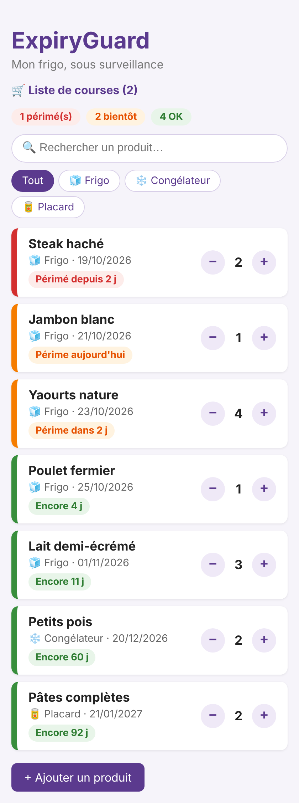
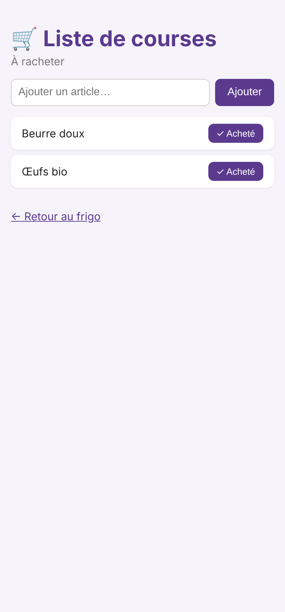

# 🛡️ ExpiryGuard

**Mon frigo, sous surveillance.** Une application Rails 8 (PWA installable) pour suivre les dates de péremption et réduire le gaspillage alimentaire.

## Aperçu

<p>
  
  &nbsp;&nbsp;
  
</p>

## Fonctionnalités

- 🎨 Code couleur selon l'urgence : périmé (rouge), bientôt (orange), OK (vert)
- 🧊 Emplacements : frigo, congélateur, placard, avec filtres
- 🔍 Recherche de produits
- ➖➕ Gestion des quantités en un clic
- 🛒 Liste de courses automatique : un produit terminé y part tout seul
- 📱 Installable comme une application (PWA)

## Stack

Ruby on Rails 8 · SQLite · Hotwire (Turbo) · CSS sur mesure · PWA

## Lancer le projet

```bash
bundle install
rails db:migrate
rails s
```

Puis ouvrir http://localhost:3000

---

Projet personnel de Sarah Abila, développeuse Full-Stack (Le Wagon, 2026) — [LinkedIn](https://linkedin.com/in/sarah-abila) · [GitHub](https://github.com/Sarah-ABILA)
